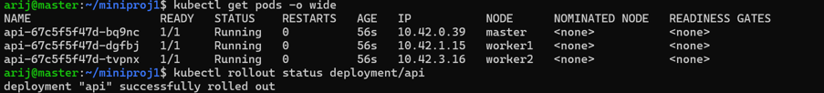
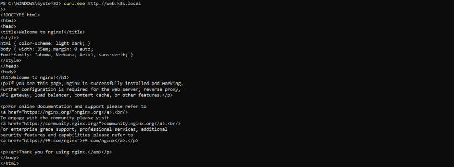
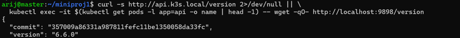
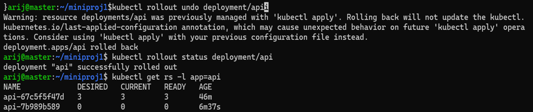
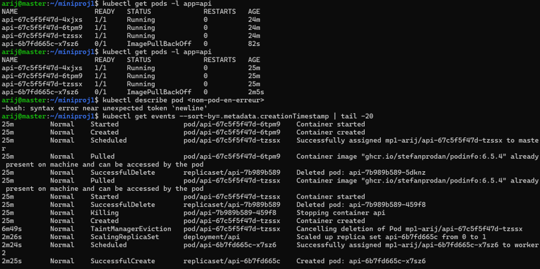
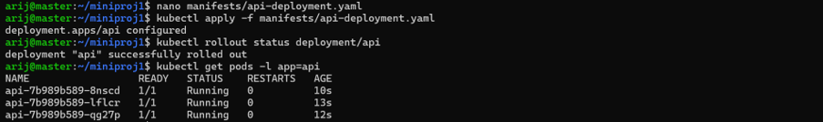
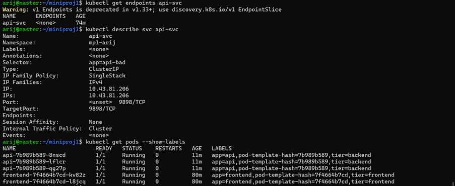

# Mini-projet 1 — Déployer une application web à deux niveaux avec Kubernetes (k3s)

## 1. Présentation du projet

Ce mini-projet déploie une application web à deux niveaux sur un cluster Kubernetes k3s composé d'un nœud control plane et de deux workers.

L'application comprend :

- **Frontend** : interface web basée sur **NGINX** (`nginx:alpine`), 2 réplicas.
- **API** : service REST **Podinfo** (`ghcr.io/stefanprodan/podinfo:6.5.4` puis `6.6.0`), 3 réplicas, port 9898.
- **Services ClusterIP** : communication interne par nom DNS.
- **Ingress Traefik** : point d'entrée HTTP unique pour `web.k3s.local` et `api.k3s.local`.

Le déploiement est **100 % déclaratif** : toutes les ressources sont décrites dans des manifestes YAML versionnés dans Git.

- **Étudiante** : Arij Belaid
- **Namespace** : `mp1-arij`
- **Dépôt GitHub** : <https://github.com/arijbelaid/mini_projet1>

---

## 2. Objectifs pédagogiques

- Déployer des applications avec des **Deployments** Kubernetes.
- Gérer les **réplicas** et les **labels**.
- Exposer les applications avec des **Services ClusterIP**.
- Tester la **résolution DNS interne** de Kubernetes.
- Configurer un **Ingress Traefik** pour plusieurs noms d'hôte.
- Effectuer une **mise à jour progressive (Rolling Update)** et un **rollback**.
- **Diagnostiquer** et corriger des pannes volontaires.
- Versionner les manifestes et les preuves dans **GitHub**.

---

## 3. Architecture

```text
                         Utilisateur
                              |
                       Poste Windows
                              |
                       Ingress Traefik
                        /           \
             web.k3s.local         api.k3s.local
                    |                    |
              frontend-svc            api-svc
               ClusterIP              ClusterIP
                    |                    |
             Deployment frontend  Deployment api
                2 réplicas            3 réplicas
                    |                    |
              NGINX Pods             Podinfo Pods
                    \                    /
                     \--- DNS interne ---/
```

### Environnement technique

| Composant | Technologie |
|---|---|
| Orchestration | Kubernetes k3s (v1.36) |
| Machines virtuelles | VMware Workstation |
| Système des nœuds | Ubuntu Server |
| Frontend | `nginx:alpine` |
| API | `ghcr.io/stefanprodan/podinfo` |
| Routage HTTP | Traefik Ingress Controller |
| Configuration | YAML |
| Versionnement | Git + GitHub |

### Nœuds du cluster

| Nœud | Rôle | IP |
|---|---|---|
| master | control-plane | 192.168.159.10 |
| worker1 | agent | 192.168.159.11 |
| worker2 | agent | 192.168.159.12 |

---

## 4. Structure du dépôt

```text
mini_projet1/
├── manifests/
│   ├── api-deployment.yaml
│   ├── frontend-deployment.yaml
│   ├── api-svc.yaml
│   ├── frontend-svc.yaml
│   └── ingress.yaml
├── screenshots/
│   └── ... (captures d'écran)
├── rapport/
│   └── Mini_projet1.pdf
├── README.md
└── .gitignore
```

---

## 5. Prérequis

- Cluster k3s à 3 nœuds en état `Ready`.
- Traefik installé et opérationnel (`kube-system`).
- Accès SSH à la VM master.
- `kubectl` configuré sur la VM master.
- Git et un dépôt GitHub.

Vérification du cluster :

```bash
kubectl get nodes -o wide
kubectl get pods -A
```

---

## 6. Déploiement

### 6.1 Créer le namespace

```bash
kubectl create namespace mp1-arij
kubectl config set-context --current --namespace=mp1-arij
```


### 6.2 Déployer l'API (3 réplicas)

```bash
kubectl apply -f manifests/api-deployment.yaml
kubectl get deployment api -n mp1-arij
kubectl get pods -n mp1-arij -o wide
```


Répartition des pods API sur les 3 nœuds (décision du **scheduler kube-scheduler**) :



### 6.3 Déployer le frontend (2 réplicas)

```bash
kubectl apply -f manifests/frontend-deployment.yaml
kubectl get deployment frontend -n mp1-arij
kubectl get pods -n mp1-arij -o wide
```


### 6.4 Créer les Services ClusterIP

```bash
kubectl apply -f manifests/api-svc.yaml
kubectl apply -f manifests/frontend-svc.yaml
kubectl get svc -n mp1-arij
```


Vérification des endpoints associés :

```bash
kubectl get endpoints -n mp1-arij
```


### 6.5 Vérifier la communication interne par DNS

Depuis un pod frontend, appel de l'API par son nom de Service :

```bash
kubectl exec -it <pod-frontend> -- wget -qO- http://api-svc:9898/version
```

Résolution DNS complète :

```bash
kubectl exec -it <pod-frontend> -- nslookup api-svc.mp1-arij.svc.cluster.local
```


### 6.6 Configurer l'Ingress Traefik

```bash
kubectl apply -f manifests/ingress.yaml
kubectl get ingress -n mp1-arij
kubectl describe ingress app-ingress -n mp1-arij
```


Côté Windows, ajout dans `C:\Windows\System32\drivers\etc\hosts` (éditeur en administrateur) :

```text
192.168.159.10 web.k3s.local api.k3s.local
```

Test depuis PowerShell :

```powershell
curl.exe http://web.k3s.local
curl.exe http://api.k3s.local/version
```



---

## 7. Mise à jour progressive et rollback

### 7.1 Préparer le test

Boucle de requêtes pour mesurer la disponibilité pendant le rollout :

```powershell
while ($true) { curl.exe -s http://api.k3s.local/version; Write-Host ""; Start-Sleep -Milliseconds 500 }
```

### 7.2 Mettre à jour l'API (6.5.4 → 6.6.0)

Modification du tag d'image dans `manifests/api-deployment.yaml`, puis :

```bash
kubectl apply -f manifests/api-deployment.yaml
kubectl rollout status deployment/api -n mp1-arij
kubectl get rs -l app=api -n mp1-arij
```

**Aucune coupure** : les requêtes continuent de répondre pendant le remplacement progressif.


Deux ReplicaSets coexistent après la mise à jour (ancien à 0, nouveau à 3) :


Nouvelle version en production :



### 7.3 Rollback

```bash
kubectl rollout undo deployment/api -n mp1-arij
kubectl rollout status deployment/api -n mp1-arij
```

Retour à la révision précédente :



---

## 8. Diagnostic des pannes

### 8.1 Panne A — Tag d'image inexistant

**Injection** : tag remplacé par `6.5.999` dans le Deployment.

**Observation** :

```bash
kubectl get pods -n mp1-arij
kubectl describe pod <nom-pod-en-erreur> -n mp1-arij
kubectl get events -n mp1-arij --sort-by=.metadata.creationTimestamp
```

Symptômes : pod en `ErrImagePull` puis `ImagePullBackOff`.


Events détaillés : `Failed to pull image "ghcr.io/stefanprodan/podinfo:6.5.999": not found`.



**Cause racine** : tag inexistant dans le registre.

**Correction** : retour au tag `6.6.0`, `kubectl apply`, puis rollouts terminés.



### 8.2 Panne B — Sélecteur de Service incorrect

**Injection** : sélecteur du Service modifié en `app: api-bad` (ne correspond à aucun pod).

**Diagnostic** :

```bash
kubectl get svc -n mp1-arij
kubectl get endpoints api-svc -n mp1-arij
kubectl describe svc api-svc -n mp1-arij
kubectl get pods -n mp1-arij --show-labels
```

Symptômes :

- `Endpoints: <none>` pour `api-svc`
- `wget: can't connect to remote host`
- `curl.exe http://api.k3s.local/version` → `503 Service Unavailable`



**Cause racine** : le sélecteur ne correspond à aucun label de pod.

**Correction** : retour de `app: api` + `tier: backend`, `kubectl apply`, endpoints restaurés.


---

## 9. Captures d'écran — Synthèse

| Capture | Résultat démontré |
|---|---|
| `02-namespace-created.png` | Namespace `mp1-arij` créé |
| `03-api-deployment-3-replicas.png` | Deployment API — 3 réplicas |
| `04-api-pods-distribution.png` | Répartition des pods API sur les 3 nœuds |
| `05-frontend-deployment-2-replicas.png` | Deployment frontend — 2 réplicas |
| `06-services-clusterip.png` | Services ClusterIP |
| `07-api-endpoints.png` | Endpoints du Service API |
| `08-frontend-api-dns-test.png` | Communication interne via DNS |
| `09-ingress-rules.png` | Règles Ingress |
| `10-traefik-ingress-test.png` | Test via Ingress Traefik |
| `13-rolling-update-no-downtime.png` | Mise à jour sans coupure |
| `14-replicasets-after-update.png` | ReplicaSets après mise à jour |
| `15-api-version-after-update.png` | Version 6.6.0 en production |
| `16-rollback-completed.png` | Rollback réussi |
| `17-image-pull-error.png` | Panne A — ImagePullBackOff |
| `18-diagnostic-events.png` | Events de la panne A |
| `19-image-error-fixed.png` | Panne A corrigée |
| `20-service-selector-error.png` | Panne B — Endpoints vides |
| `21-service-selector-corrected.png` | Panne B corrigée |

---

## 10. Réponses aux questions pédagogiques

### Étape 0 — Pourquoi un namespace ?

Un namespace isole logiquement les ressources d'un projet dans un cluster partagé. Il permet :

- d'éviter les collisions de noms entre projets,
- d'appliquer des quotas et du RBAC,
- de nettoyer facilement (`kubectl delete namespace mp1-arij`).

### Étape 1 — Répartition des pods API

Les pods sont placés par le **scheduler kube-scheduler**, qui choisit les nœuds selon les ressources disponibles, les contraintes (`affinity`, `taints/tolerations`) et l'équilibrage. Ici : 1 pod par nœud.

### Étape 2 — Labels distincts

Si les deux Deployments partageaient les mêmes labels, leurs ReplicaSets se disputeraient les mêmes pods et les Services pourraient router vers les mauvais backends. Les labels `app` et `tier` évitent cette ambiguïté.

### Étape 3 — DNS et endpoints

Nom DNS complet d'un Service :

```text
<service>.<namespace>.svc.cluster.local
api-svc.mp1-arij.svc.cluster.local
```

`kubectl get endpoints` liste les IP:port réelles des pods ciblés par le Service. Un endpoint vide (`<none>`) révèle un sélecteur incorrect ou des pods non prêts.

### Étape 4 — Pourquoi un Ingress ?

L'Ingress centralise le routage HTTP par nom d'hôte ou chemin vers plusieurs Services. Contrairement aux NodePort (qui exposent un port par Service), il offre :

- un point d'entrée unique (80/443),
- la terminaison TLS centralisée,
- un routage plus propre et plus évolutif.

### Étape 5 — ReplicaSets et rollback

Après une mise à jour, **2 ReplicaSets** coexistent : l'ancien (scalé à 0) et le nouveau (scalé à 3). L'ancien est conservé pour permettre le rollback (`kubectl rollout undo deployment/api`) et garder l'historique des révisions.

### Étape 6 — Diagnostic

Démarche progressive :

1. **Observer** l'état global : `kubectl get pods`, `kubectl get endpoints`.
2. **Décrire** la ressource en erreur : `kubectl describe pod/svc`.
3. **Consulter les events** : `kubectl get events`.
4. **Comparer** labels des pods et sélecteurs des Services.
5. **Corriger** la cause racine puis revérifier.

---

## 11. Difficultés rencontrées et enseignements

- **Kubeconfig k3s inaccessible** depuis l'utilisateur non-root : résolu en définissant `export KUBECONFIG=$HOME/.kube/config` dans `~/.bashrc`.
- **Fichier hosts Windows** non modifiable via le Bloc-notes (permissions) : contourné avec `Add-Content` en PowerShell administrateur.
- **Erreur d'indentation YAML** sur le sélecteur du Service (`spec.app` invalide) : rappel de toujours faire `kubectl apply --dry-run=client` avant d'appliquer.

**Enseignements** : cohérence labels / sélecteurs, rôle du DNS interne, intérêt des manifestes déclaratifs, valeur du rollout/rollback pour la disponibilité, et importance de la démarche méthodique de diagnostic (`get` → `describe` → `events`).

---

## 12. Conclusion

Ce mini-projet met en pratique les fondations de Kubernetes avec k3s : déploiement déclaratif, réplication, découverte de services, exposition HTTP par Ingress, mise à jour progressive et diagnostic de pannes. Tous les manifestes et preuves sont versionnés dans ce dépôt Git, rendant le déploiement entièrement reproductible.

---

## 13. Auteur

- **Étudiante** : Arij Belaid
- **Formation** : Master Professionnel DevOps & Cloud
- **Établissement** : ISET Tozeur
- **Module** : Orchestration de conteneurs avec Kubernetes (k3s)
