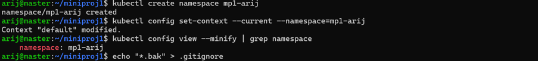
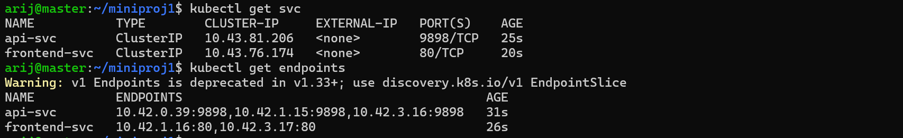
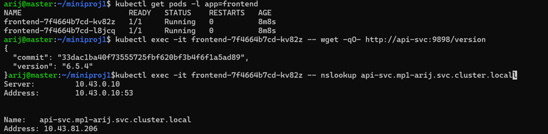
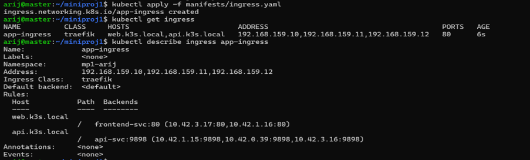
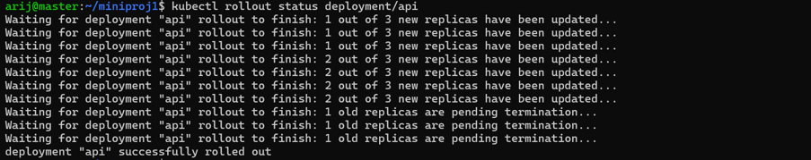
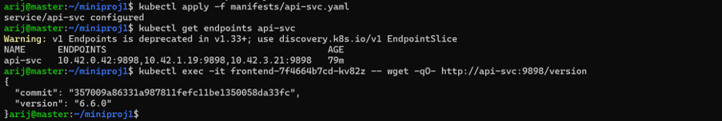

# Mini-projet 1 — Déployer une application web à deux niveaux avec Kubernetes (k3s)

**Étudiante** : Arij Belaid — **Module** : Orchestration de conteneurs avec Kubernetes (k3s) — **Établissement** : ISET Tozeur  
**Namespace** : `mp1-arij` — **Dépôt** : <https://github.com/arijbelaid/mini_projet1>

---

## 1. Présentation

Déploiement déclaratif d'une application web à deux niveaux sur un cluster **k3s** (1 control plane + 2 workers) :

- **Frontend** : NGINX (`nginx:alpine`), 2 réplicas.
- **API** : Podinfo (`ghcr.io/stefanprodan/podinfo`), 3 réplicas, port 9898.
- **Services ClusterIP** : communication interne par DNS.
- **Ingress Traefik** : point d'entrée HTTP unique pour `web.k3s.local` et `api.k3s.local`.

Toutes les ressources sont décrites dans des manifestes YAML versionnés dans Git.

---

## 2. Architecture

```text
                         Utilisateur
                              |
                       Poste Windows
                              |
                       Ingress Traefik
                        /           \
             web.k3s.local         api.k3s.local
                    |                    |
              frontend-svc            api-svc
               ClusterIP              ClusterIP
                    |                    |
             Deployment frontend  Deployment api
                2 réplicas            3 réplicas
                    |                    |
              NGINX Pods             Podinfo Pods
                    \                    /
                     \--- DNS interne ---/
```

| Composant | Technologie |
|---|---|
| Orchestration | Kubernetes k3s v1.36 |
| Nœuds | Ubuntu Server (1 master + 2 workers) |
| Frontend | `nginx:alpine` |
| API | `ghcr.io/stefanprodan/podinfo:6.5.4` → `6.6.0` |
| Routage HTTP | Traefik Ingress Controller |
| Versionnement | Git + GitHub |

---

## 3. Structure du dépôt

```text
mini_projet1/
├── manifests/
│   ├── api-deployment.yaml
│   ├── frontend-deployment.yaml
│   ├── api-svc.yaml
│   ├── frontend-svc.yaml
│   └── ingress.yaml
├── screenshots/
├── rapport/
│   └── Mini_projet1.pdf
├── README.md
└── .gitignore
```

---

## 4. ÉTAPE 0 — Préparer le terrain

Création du dépôt Git, du namespace `mp1-arij` et définition de ce namespace par défaut.

```bash
mkdir -p ~/miniproj1/manifests && cd ~/miniproj1
git init
kubectl create namespace mp1-arij
kubectl config set-context --current --namespace=mp1-arij
echo "*.bak" > .gitignore
```



**Question — pourquoi isoler un projet dans un namespace ?**  
Un namespace isole logiquement les ressources d'un projet dans un cluster partagé : pas de collision de noms, quotas et RBAC applicables, nettoyage facile (`kubectl delete namespace`).

---

## 5. ÉTAPE 1 — Déployer l'API (3 réplicas)

```bash
kubectl create deployment api \
  --image=ghcr.io/stefanprodan/podinfo:6.5.4 \
  --replicas=3 \
  --dry-run=client -o yaml > manifests/api-deployment.yaml

kubectl apply -f manifests/api-deployment.yaml
kubectl get pods -o wide
kubectl rollout status deployment/api
```


**Question — sur quels nœuds et qui décide ?**  
Les 3 pods sont répartis automatiquement par le **scheduler `kube-scheduler`** : 1 par nœud (master, worker1, worker2). Il choisit selon les ressources disponibles, les contraintes (`affinity`, `taints`) et l'équilibrage.

---

## 6. ÉTAPE 2 — Déployer le frontend (2 réplicas)

```bash
kubectl create deployment frontend \
  --image=nginx:alpine \
  --replicas=2 \
  --dry-run=client -o yaml > manifests/frontend-deployment.yaml

kubectl apply -f manifests/frontend-deployment.yaml
kubectl get pods -o wide
```


**Question — mêmes labels partout ?**  
Les ReplicaSets se disputeraient les mêmes pods et les Services routeraient vers les mauvais backends. Les labels `app` + `tier` garantissent une sélection unique.

---

## 7. ÉTAPE 3 — Services ClusterIP et DNS interne

```bash
kubectl apply -f manifests/api-svc.yaml
kubectl apply -f manifests/frontend-svc.yaml
kubectl get svc
kubectl get endpoints
```




Test DNS depuis un pod frontend :

```bash
kubectl exec -it <pod-frontend> -- wget -qO- http://api-svc:9898/version
kubectl exec -it <pod-frontend> -- nslookup api-svc.mp1-arij.svc.cluster.local
```



**Question — nom DNS complet ?**  
`<service>.<namespace>.svc.cluster.local` → ici `api-svc.mp1-arij.svc.cluster.local` (résolu en `10.43.81.206`).

**Question — rôle de `get endpoints` ?**  
Liste les IP:port des pods réellement ciblés. Un endpoint vide (`<none>`) révèle un sélecteur erroné ou des pods non prêts.

---

## 8. ÉTAPE 4 — Ingress Traefik

```bash
kubectl apply -f manifests/ingress.yaml
kubectl get ingress
kubectl describe ingress app-ingress
```



Côté Windows, ajout dans `C:\Windows\System32\drivers\etc\hosts` :

```text
192.168.159.10 web.k3s.local api.k3s.local
```

Test PowerShell :

```powershell
curl.exe http://web.k3s.local
curl.exe http://api.k3s.local/version
```


**Question — pourquoi un Ingress plutôt que 2 NodePort ?**  
Un seul point d'entrée (80/443), routage par nom d'hôte, TLS centralisable, pas de ports 30000-32767 exposés, plus propre et évolutif.

---

## 9. ÉTAPE 5 — Mise à jour sans coupure et rollback

Boucle de requêtes (PowerShell) :

```powershell
while ($true) { curl.exe -s http://api.k3s.local/version; Write-Host ""; Start-Sleep -Milliseconds 500 }
```

Modification du tag dans `manifests/api-deployment.yaml` (`6.5.4` → `6.6.0`), puis :

```bash
kubectl apply -f manifests/api-deployment.yaml
kubectl rollout status deployment/api
kubectl get rs -l app=api
```




Rollback :

```bash
kubectl rollout undo deployment/api
kubectl rollout status deployment/api
```


**Question — combien de ReplicaSets après mise à jour ?**  
**2** : l'ancien (scalé à 0, conservé pour `rollout undo`) et le nouveau (scalé à 3).  
**Commande de rollback** : `kubectl rollout undo deployment/api`.

---

## 10. ÉTAPE 6 — Panne et diagnostic

### Panne A — Tag d'image inexistant

Injection : tag remplacé par `6.5.999` dans `api-deployment.yaml`.

```bash
kubectl apply -f manifests/api-deployment.yaml
kubectl get pods -l app=api
```


Diagnostic :

```bash
kubectl get events --sort-by=.metadata.creationTimestamp | tail -20
```


**Symptômes** : pod `ImagePullBackOff` / `ErrImagePull`, event `Failed to pull image "...6.5.999": not found`.  
**Cause racine** : tag inexistant dans le registre.

Correction (retour à `6.6.0`) :

```bash
kubectl apply -f manifests/api-deployment.yaml
kubectl rollout status deployment/api
```


### Panne B — Sélecteur de Service incorrect

Injection : `app: api` → `app: api-bad` dans `api-svc.yaml`.

```bash
kubectl apply -f manifests/api-svc.yaml
kubectl get endpoints api-svc
kubectl describe svc api-svc
kubectl get pods --show-labels
```


**Symptômes** : `endpoints <none>`, `curl` via Ingress → `503 Service Unavailable / no available server`, `wget` interne → `Connection refused`.  
**Cause racine** : le sélecteur `app=api-bad` ne correspond à aucun label de pod.

Correction (retour à `app: api` + `tier: backend`) :

```bash
kubectl apply -f manifests/api-svc.yaml
kubectl get endpoints api-svc
```



---

## 11. Tableau de synthèse des exigences

| Exigence | Statut | Preuve |
|---|---|---|
| E1 — Namespace dédié | ✅ | `etape0-01-namespace.png` |
| E2 — API : 3 réplicas, tag explicite | ✅ | `etape1-01-api-deployment.png` |
| E3 — Frontend : 2 réplicas | ✅ | `etape2-01-frontend-deployment.png` |
| E4 — Labels `app` + `tier` cohérents | ✅ | manifestes |
| E5 — Services ClusterIP | ✅ | `etape3-01-services.png` |
| E6 — DNS interne frontend → API | ✅ | `etape3-03-dns-test.png` |
| E7 — Ingress pour les 2 hôtes | ✅ | `etape4-01-ingress.png` |
| E8 — Manifestes YAML versionnés | ✅ | dépôt Git |
| E9 — Rolling update sans coupure | ✅ | `etape5-01-rolling-update.png` |
| E10 — Diagnostic de 2 pannes | ✅ | `etape6-01` → `etape6-05` |

---

## 12. Difficultés rencontrées et enseignements

- **Kubeconfig k3s inaccessible** en tant qu'utilisateur non-root : résolu par `export KUBECONFIG=$HOME/.kube/config` dans `~/.bashrc`.
- **Fichier hosts Windows non modifiable via Bloc-notes** : contourné avec `Add-Content` en PowerShell administrateur.
- **Erreur d'indentation YAML** sur le sélecteur du Service (`spec.app` invalide) : toujours vérifier avec `kubectl apply --dry-run=client`.

**Enseignements** : cohérence labels/sélecteurs indispensable, rôle central du DNS interne, intérêt des manifestes déclaratifs versionnés, et valeur du rollout/rollback pour la disponibilité.

---

## 13. Conclusion

Ce mini-projet met en pratique les fondations de Kubernetes avec k3s : déploiement déclaratif, réplication, découverte de services, exposition HTTP par Ingress, mise à jour progressive et diagnostic méthodique de pannes. L'ensemble est entièrement reproductible grâce aux manifestes et aux preuves versionnés dans ce dépôt.
