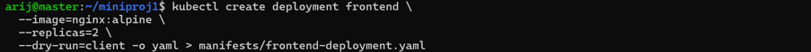
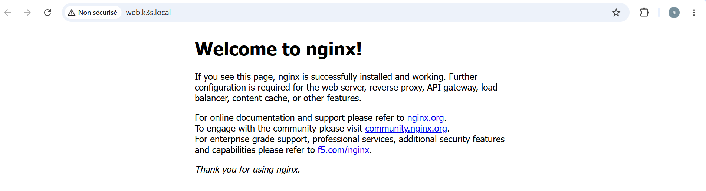
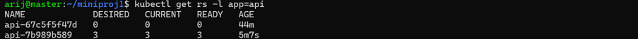
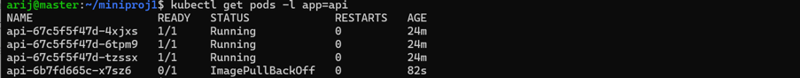

# Mini-projet 1 — Déployer une application web à deux niveaux avec Kubernetes (k3s)

**Étudiante** : Arij Belaid — **Module** : Orchestration de conteneurs avec Kubernetes (k3s) — **Établissement** : ISET Tozeur  
**Namespace** : `mp1-arij` — **Dépôt** : <https://github.com/arijbelaid/mini_projet1>

---

## Architecture cible

```text
                         Utilisateur
                              |
                       Poste Windows
                              |
                       Ingress Traefik
                        /           \
             web.k3s.local         api.k3s.local
                    |                    |
              frontend-svc            api-svc
               ClusterIP              ClusterIP
                    |                    |
             Deployment frontend  Deployment api
                2 réplicas            3 réplicas
                    |                    |
              NGINX Pods             Podinfo Pods
                    \                    /
                     \--- DNS interne ---/
```

| Composant | Technologie |
|---|---|
| Orchestration | Kubernetes k3s v1.36 |
| Nœuds | master / worker1 / worker2 (Ubuntu Server) |
| Frontend | `nginx:alpine` (2 réplicas) |
| API | `ghcr.io/stefanprodan/podinfo` 6.5.4 → 6.6.0 (3 réplicas, port 9898) |
| Routage HTTP | Traefik Ingress Controller |
| Configuration | YAML versionné dans Git |

---

## ÉTAPE 0 — Préparer le terrain

```bash
mkdir -p ~/miniproj1/manifests && cd ~/miniproj1
git init
git config user.name "arijbelaid"
git config user.email "aarijbelaid@gmail.com"
kubectl create namespace mp1-arij
kubectl config set-context --current --namespace=mp1-arij
kubectl config view --minify | grep namespace
echo "*.bak" > .gitignore
```

**Figure 1** — Namespace `mp1-arij` créé et défini par défaut :


**Question — pourquoi isoler un projet dans un namespace ?**  
Isolation logique entre projets d'un même cluster : pas de collision de noms, quotas et RBAC applicables, nettoyage facile (`kubectl delete namespace`).

---

## ÉTAPE 1 — Déployer l'API (3 réplicas)

```bash
kubectl create deployment api \
  --image=ghcr.io/stefanprodan/podinfo:6.5.4 \
  --replicas=3 \
  --dry-run=client -o yaml > manifests/api-deployment.yaml

kubectl apply -f manifests/api-deployment.yaml
kubectl get pods -o wide
kubectl rollout status deployment/api
```

**Figure 2** — Déploiement API, 3 réplicas :


**Figure 3** — Répartition des pods API sur les 3 nœuds :


**Question — sur quels nœuds et qui décide ?**  
Les 3 pods sont répartis automatiquement par le **scheduler `kube-scheduler`** : 1 par nœud (master / worker1 / worker2), selon les ressources, les contraintes (`affinity`, `taints`) et l'équilibrage.

---

## ÉTAPE 2 — Déployer le frontend (2 réplicas)

```bash
kubectl create deployment frontend \
  --image=nginx:alpine \
  --replicas=2 \
  --dry-run=client -o yaml > manifests/frontend-deployment.yaml

kubectl apply -f manifests/frontend-deployment.yaml
kubectl get pods -o wide
```

**Figure 4** — Frontend NGINX, 2 réplicas :



**Question — mêmes labels partout ?**  
Les ReplicaSets se disputeraient les mêmes pods, les Services routeraient vers les mauvais backends. Les labels `app` + `tier` garantissent une sélection unique.

---

## ÉTAPE 3 — Services ClusterIP et DNS interne

```bash
kubectl apply -f manifests/api-svc.yaml
kubectl apply -f manifests/frontend-svc.yaml
kubectl get svc
kubectl get endpoints
```

**Figure 5** — Services ClusterIP `api-svc` et `frontend-svc` :


**Figure 6** — Endpoints associés aux Services :


Test DNS depuis un pod frontend :

```bash
kubectl exec -it <pod-frontend> -- wget -qO- http://api-svc:9898/version
kubectl exec -it <pod-frontend> -- nslookup api-svc.mp1-arij.svc.cluster.local
```

**Figure 7** — Communication interne frontend → API via DNS :


**Question — nom DNS complet ?**  
`<service>.<namespace>.svc.cluster.local` → ici `api-svc.mp1-arij.svc.cluster.local` (résolu en `10.43.81.206`).

**Question — rôle de `get endpoints` ?**  
Liste les IP:port réelles des pods ciblés par le Service. Un endpoint vide (`<none>`) révèle un sélecteur erroné ou des pods non prêts.

---

## ÉTAPE 4 — Ingress Traefik

```bash
kubectl apply -f manifests/ingress.yaml
kubectl get ingress
kubectl describe ingress app-ingress
```

**Figure 8** — Règles Ingress `web.k3s.local` et `api.k3s.local` :


Côté Windows, ajout dans `C:\Windows\System32\drivers\etc\hosts` :

```text
192.168.159.10 web.k3s.local api.k3s.local
```

Test PowerShell :

```powershell
ping web.k3s.local
curl.exe http://web.k3s.local
curl.exe http://api.k3s.local/version
```

**Figure 9** — Test `ping` + `curl` depuis Windows via Traefik :


**Question — pourquoi un Ingress plutôt que 2 NodePort ?**  
Un seul point d'entrée (80/443), routage par nom d'hôte, TLS centralisable, pas de ports 30000-32767 exposés, plus propre et évolutif.


**Figure 19** — Accès au frontend NGINX depuis le navigateur Windows via `http://web.k3s.local` :



---

## ÉTAPE 5 — Mise à jour sans coupure et rollback

Boucle de requêtes (PowerShell) :

```powershell
while ($true) { curl.exe -s http://api.k3s.local/version; Write-Host ""; Start-Sleep -Milliseconds 500 }
```

**Figure 10** — Boucle de requêtes pendant la mise à jour, aucune coupure :


Modification du tag dans `manifests/api-deployment.yaml` (`6.5.4` → `6.6.0`), puis :

```bash
kubectl apply -f manifests/api-deployment.yaml
kubectl rollout status deployment/api
kubectl get rs -l app=api
```

**Figure 11** — Deux ReplicaSets après mise à jour (ancien à 0, nouveau à 3) :



**Figure 12** — Version `6.6.0` en production :


Rollback :

```bash
kubectl rollout undo deployment/api
kubectl rollout status deployment/api
```

**Figure 13** — Retour à la révision précédente :


**Question — combien de ReplicaSets après la mise à jour ?**  
**2** : l'ancien (scalé à 0, conservé pour `rollout undo` et l'historique) et le nouveau (scalé à 3).  
**Commande de rollback** : `kubectl rollout undo deployment/api`.

---

## ÉTAPE 6 — Panne et diagnostic

### Panne A — Tag d'image inexistant

Injection : `6.6.0` → `6.5.999` dans `api-deployment.yaml`, puis :

```bash
kubectl apply -f manifests/api-deployment.yaml
kubectl get pods -l app=api
```

**Figure 14** — Pod en `ImagePullBackOff` :



Diagnostic :

```bash
kubectl get events --sort-by=.metadata.creationTimestamp | tail -20
```

**Figure 15** — Events : `Failed to pull image "...6.5.999": not found` :


**Symptômes** : `ImagePullBackOff` / `ErrImagePull`, event `Failed to pull image ... not found`.  
**Cause racine** : tag inexistant dans le registre.

Correction (retour à `6.6.0`) :

```bash
kubectl apply -f manifests/api-deployment.yaml
kubectl rollout status deployment/api
```

**Figure 16** — 3 pods API restaurés après correction :


### Panne B — Sélecteur de Service incorrect

Injection : `app: api` → `app: api-bad` dans `api-svc.yaml`, puis :

```bash
kubectl apply -f manifests/api-svc.yaml
kubectl get endpoints api-svc
kubectl describe svc api-svc
kubectl get pods --show-labels
```

**Figure 17** — Endpoints vides (`<none>`) et `Selector: app=api-bad` :


**Symptômes** :
- `endpoints <none>`
- `curl.exe http://api.k3s.local/version` → `503 Service Unavailable / no available server`
- `wget` interne → `Connection refused`

**Cause racine** : le sélecteur `app=api-bad` ne correspond à aucun label de pod.

Correction (retour à `app: api` + `tier: backend`) :

```bash
kubectl apply -f manifests/api-svc.yaml
kubectl get endpoints api-svc
```

**Figure 18** — Endpoints restaurés (3 IPs) + curl 200 → `6.6.0` :


---

## Conclusion

Ce mini-projet met en pratique les fondations de Kubernetes avec k3s : déploiement déclaratif, réplication, découverte de services, exposition HTTP par Ingress, mise à jour progressive et diagnostic méthodique de pannes. L'ensemble est entièrement reproductible grâce aux manifestes et aux preuves versionnés dans ce dépôt.

---

## Auteur

- **Étudiante** : Arij Belaid
- **Formation** : Master Professionnel DevOps & Cloud
- **Établissement** : ISET Tozeur
- **Module** : Orchestration de conteneurs avec Kubernetes (k3s)
